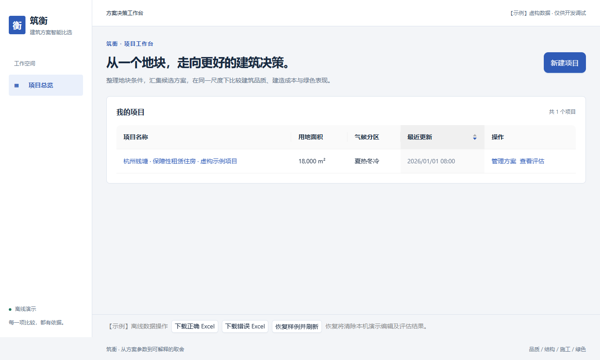
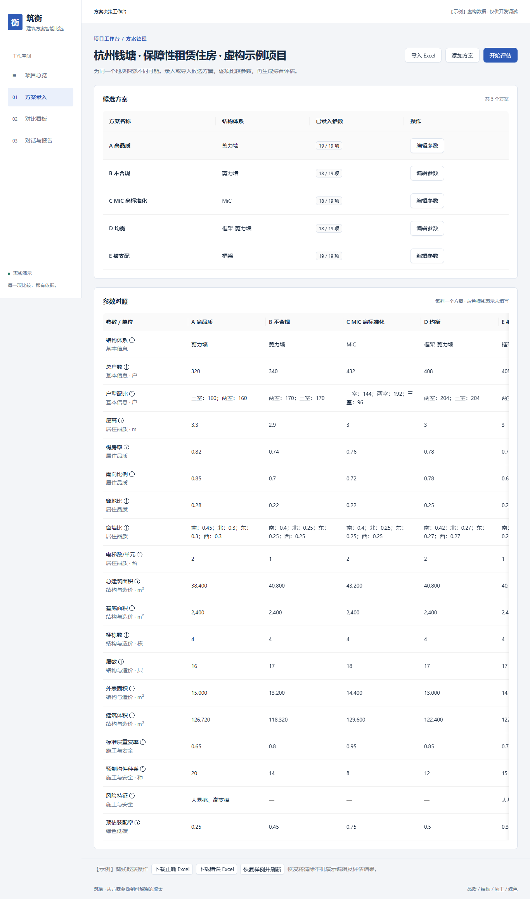
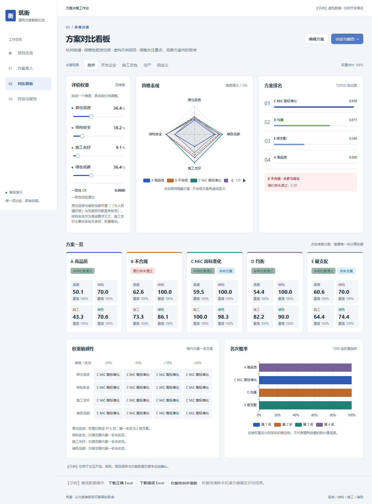
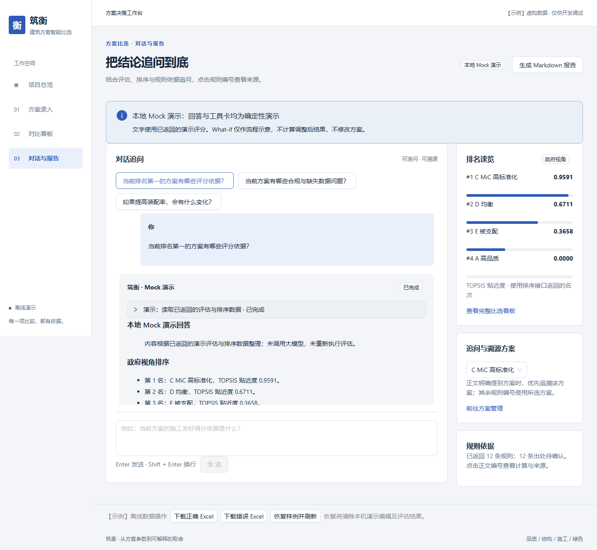

# T7：前端 MVP

分支：`feat/frontend-mvp`；基于 `feat/rules-engine`。独立工作树开发，未改动其他 Agent 的 `feat/mcdm`。真实排序依赖 T4 合并，真实对话与报告依赖 T8。

## 做了什么

- 实现项目总览、项目与方案录入、参数对照、全部导入错误展示和评估跳转。
- 从 Pydantic 导出标准 JSON Schema，通过 `npm run gen:types` 生成 TypeScript 类型；字段元数据增加中文 description，表单按 group 自动渲染单位、说明和约束。
- 按资源封装 API，引入 TanStack Query 管理缓存与请求状态。离线模式支持本地保存和引擎结果回放，编辑后使旧评估失效。
- 完成角色与权重面板、150 ms 排序防抖、排名换位动画、不合规列表、雷达图、维度评分与覆盖率、帕累托徽章、敏感性与名次概率。
- 完成共用溯源抽屉：原始输入、公式、评分分段、当前点、规则编号及出处。
- 完成对话、可折叠工具卡、规则引用、可取消 SSE、Markdown 报告与下载；真实请求失败明确报错。
- 统一主题与维度颜色，补全加载、空数据、错误状态；补充两种投影分辨率截图和交互录屏。

新增依赖说明：TanStack Query 5.104.1 用于跨页缓存和失效管理；json-schema-to-typescript 15.0.4 用于模式生成；react-markdown 10.1.0 用于安全 Markdown 展示；tsx 4.23.15 与 Playwright 1.58.2 用于 TypeScript 测试及浏览器验收，`@types/node` 用于测试类型。具体解析版本锁定于 package-lock。沿用 React 18、Ant Design 5、ECharts 5 和 Vite 5，未替换项目技术栈。

本次按已确认的离线开发方案，仅离线自定义滑杆使用 JS TOPSIS；真实模式不在浏览器计算业务结果。标准 JSON Schema 增加在 `data/schema/jsonschema/`，保留原字段清单格式。

## 如何运行

```powershell
cd frontend
npm ci
npm run dev:mock -- --host 127.0.0.1 --port 5177
```

打开 `http://127.0.0.1:5177/projects`。从样例项目进入方案管理并开始评估；页尾可下载正确/错误 Excel。新项目导入正确 Excel 后可完成评估、排序、对话和报告演示。

连接后端：在根 `.env` 配置 `VITE_BACKEND_URL`，运行后端与 `npm run dev`。完整的数据边界、导出命令和 SSE 协议见 [使用与联调说明](../docs/frontend-mvp.md)。

## 如何测试

| 验证 | 实跑结果 |
| --- | --- |
| `npm test` | 43 通过，0 失败、0 跳过 |
| `npm run lint` | TypeScript 严格检查通过 |
| `npm run build` / `npm run build:mock` | 均通过，有大包体积提示 |
| 完整后端 `pytest` | 295 通过，2 条依赖弃用警告 |
| 后端与本次 Python 脚本 Ruff | 检查通过；修改文件格式检查通过 |
| `npm run test:ui` | 完整流程通过；无页面运行时异常 |
| 真实后端联调 | 独立数据库返回 5 个评估、4 个排名；未触碰已有项目数据 |

数学对照覆盖 286 个真实引擎权重点；前端测试还覆盖跨项目隔离、修改后失效、完整导入错误、UTF-8 拆包、取消与断流。浏览器覆盖导入、评估、角色与滑杆、溯源、快捷追问、规则引用、报告下载及新项目完整流程。

### 截图和录屏









- [1920×1080 看板](../docs/screenshots/t7/dashboard-1920.png)
- [评分溯源抽屉](../docs/screenshots/t7/trace-1366.png)
- [真实后端看板](../docs/screenshots/t7/dashboard-real.png)
- [角色切换与滑杆引发排名换位的录屏](../docs/screenshots/t7/roles-and-weights.webm)
- [浏览器验收记录](../docs/screenshots/t7/verification.json)

## 遗留问题

1. **角色切换直接换位尚未满足**：原始样例四种角色名次一致。录屏保留真实结果，展示权重、贴近度变化，并用 100% 品质权重演示 E 升到第一；没有伪造角色结果。需另行确定能产生角色换位的演示数据。
2. T8 尚无真实聊天/报告接口；目前验证了模拟流成功和真实 404 错误展示。事件协议暂定，需按 T8 定稿集中调整适配器并联调成功流。
3. T4 未合并，排序类型按草案手写；须在 T4 合并后生成类型，明确数组输入顺序或返回 `participant_ids`。
4. 离线模式不支持任意参数组合评估与任意 Excel 解析。支持预设完整组合及提供的导入文件；其余请求明确提示连接后端。非网格权重没有敏感性和概率快照，相关区域明确显示不可用。
5. 建筑规则、评分阈值、来源与角色模板仍为示例；`TODO(专业组)` 均保留，须由专业组确认，未增加规范或行业数据。
6. Vite 提示部分包大于 500 kB；构建成功，图表依赖与离线快照可后续按需拆分。看板与对话已按路由延迟加载。
7. 扩大检查到未修改的旧脚本时，发现 `scripts/export_schemes.py` 的导入顺序及 `scripts/import_schemes.py` 的导入顺序/未使用导入问题；超出 T7 范围未修改。项目既定 lint 范围和本次修改脚本均通过。
