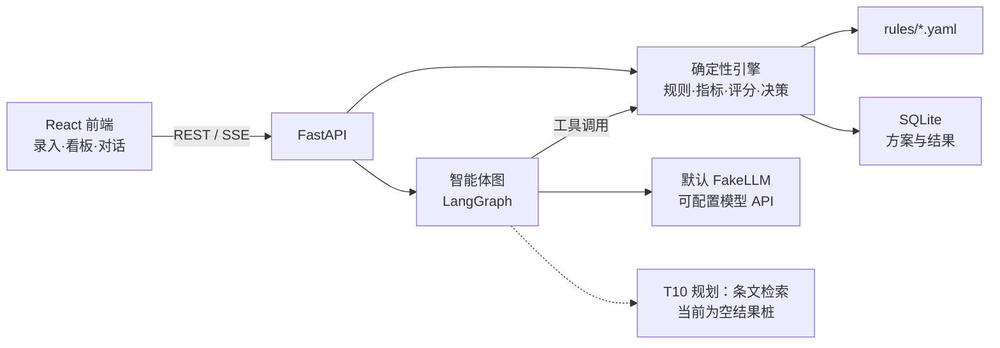
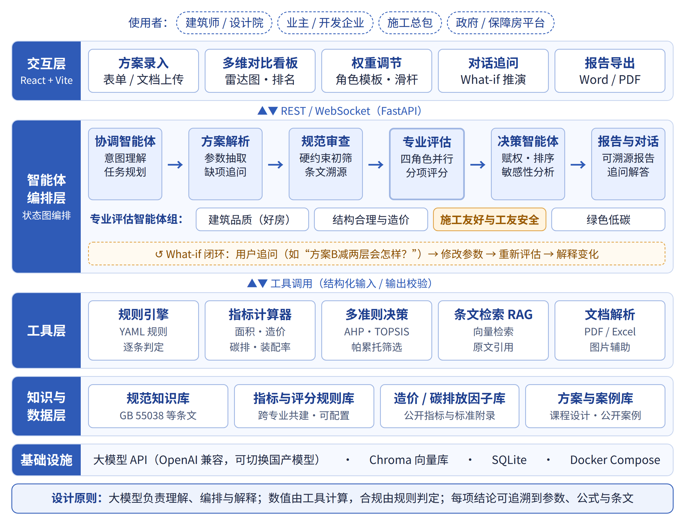
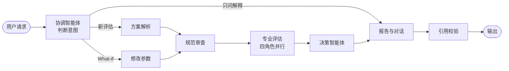

# 筑衡 · 团队内部项目规划与设计方案
筑衡：面向“好房子”建设的建筑方案智能比选智能体

> T1–T9 已集成；本文保留团队设计与后续规划。当前接口以代码和 OpenAPI 为准，使用入口见 [docs/README.md](./docs/README.md)。T10 条文检索尚未实现，现有规则与角色权重均为待专业组核定的示例，不能作为工程验证依据。

“筑衡”采用“交互层—智能体编排层—工具层—知识与数据层”的分层架构（见图1）。核心设计原则是：大模型负责理解需求、规划任务和解释结果；数值由确定性工具计算，合规由规则引擎判定；每一项评分和结论都能追溯到输入参数、计算公式和规范条文。这样既发挥大模型在理解和交互上的优势，又避免其在工程计算和规范判断上的“幻觉”风险。
本项目围绕大赛“为人民建好房，为工友谋幸福”主题，选择“智能设计与方案优化”方向，开发建筑方案智能比选智能体“筑衡”。“筑衡”面向方案设计阶段，对多个候选方案依次进行规范合规初筛、多维量化评估和多准则比选，生成每项结论都可追溯的比选报告，并支持用自然语言追问、推演方案调整的影响。其中，“建好房”对应居住品质维度，“谋幸福”对应施工友好与工友安全维度，二者在同一决策框架中被显式、量化地权衡。


## 一、技术栈

选型原则：只用成熟、中文资料多、计算机同学已经熟悉的工具；核心算法（规则引擎、AHP、TOPSIS）自己实现，答辩时能讲清楚每一步。

| 层 | 选型 | 理由 |
| --- | --- | --- |
| 前端 | React + TypeScript + Vite | 计算机同学熟悉，生态成熟 |
| UI 组件 | Ant Design | 表单、表格、滑杆现成，中文文档全；工业设计同学在其基础上定制主题色 |
| 图表 | ECharts（echarts-for-react） | 雷达图、平行坐标图、热力图均内置 |
| 后端 | Python 3.11+ + FastAPI + Pydantic v2 | 数值计算和 AI 生态都在 Python；Pydantic 同时承担数据模式和校验 |
| 智能体编排 | LangGraph | 状态图适合固定主链路 + 追问回环；如果上手慢，手写状态机也完全够用 |
| 大模型 | 默认 FakeLLM；可配置 OpenAI 兼容接口 | FakeLLM 用于确定性联调，真实服务需单独验收 |
| 向量检索（T10 规划） | bge-m3 嵌入 + Chroma | 当前 `search_clause` 返回空列表，规范原文与索引待接入 |
| 规则与指标 | YAML + 自写规则引擎（AST 白名单校验 + `simpleeval`） | 不用 `eval`；字典下标仅允许指定字段与固定字符串键 |
| 决策算法 | NumPy | AHP 特征向量、TOPSIS 各几十行代码 |
| 数据库 | SQLite + SQLModel | 零运维，演示规模足够 |
| 报告导出 | 已实现 Markdown；Word / Pandoc 为后续规划 | 当前通过 SSE 生成报告，导出与协议见使用文档 |
| 部署 | Docker Compose；GitHub Actions 发布到 jnove.vm | Nginx 托管前端，Uvicorn 后端，Caddy 转发 `/steelyard/`；见 [部署指南](./docs/deployment.md) |
| 协作 | GitHub 私有仓库 + Issues；Figma；本文档 | 代码、设计、规划各有一处 |

开发效率：样板代码和前端页面可以用 AI 编程工具（如 Claude Code）加速，但规则引擎、评分和决策算法要自己彻底搞懂，评委答辩一定会问。

## 二、系统设计

系统分成“确定性引擎”和“智能体”两半：引擎负责所有数字，智能体负责理解和解释。引擎不依赖大模型也能独立运行，这样 M1 可以先跑通，演示现场断网也能展示排名。

### 运行架构



权重滑杆只调用引擎重新排序，不经过大模型，响应应在毫秒级；只有生成报告和追问才走智能体图。


### 主要目录

```text
zhuheng/
├── backend/app/
│   ├── main.py              # FastAPI 入口
│   ├── api/                 # 路由：projects, schemes, evaluate, rank, chat, report
│   ├── models/              # Pydantic / SQLModel：Project, Scheme, EvalResult
│   ├── engine/
│   │   ├── rules.py         # 规则加载、校验、判定
│   │   ├── metrics.py       # 指标计算函数
│   │   ├── scoring.py       # 评分函数（分段线性等）
│   │   └── mcdm.py          # AHP、TOPSIS、敏感性、帕累托
│   ├── agents/              # LangGraph 节点与图定义、提示词
│   └── rag/                 # T10 预留目录，条文检索尚未实现
├── backend/tests/
├── rules/                   # 土木、建筑同学维护
│   ├── compliance.yaml  quality.yaml  structure.yaml
│   ├── construction.yaml  green.yaml
│   └── weights.yaml         # 角色权重模板
├── data/
│   ├── schemes/             # 测试方案 Excel / JSON
│   ├── factors/             # 造价、碳排放因子
│   └── clauses/             # 规范条文原文待收集
├── frontend/                # React + Vite
├── scripts/                 # check_rules.py, import_schemes.py
├── docs/                    # 当前指南、未决事项与历史归档
├── docker-compose.yml
├── docker-compose.production.yml # CI 服务器发布
└── README.md
```

### 数据模型

两类输入：**项目**（地块条件）对所有方案相同，**方案**是比选对象。下表说明设计意图；当前字段、单位、枚举与派生量以 [字段对照表](./docs/fields.generated.md) 和模型为准，专业指标仍需核定。

| 字段 | 含义 | 单位 | 归属 |
| --- | --- | --- | --- |
| `site_area` | 用地面积 | m² | 项目 |
| `far_max` / `density_max` / `height_max` | 容积率、建筑密度、限高上限 | — / % / m | 项目 |
| `climate_zone` | 建筑气候区（浙江为夏热冬冷） | — | 项目 |
| `gfa` / `footprint` | 总建筑面积、基底面积 | m² | 方案 |
| `buildings` / `floors` / `floor_height` | 楼栋数、层数、层高 | 栋 / 层 / m | 方案 |
| `structure_type` | 剪力墙 / 框剪 / 框架 / 钢结构 / MiC | — | 方案 |
| `units` / `unit_mix` | 户数、户型配比 | 户 / — | 方案 |
| `inner_area_ratio` | 得房率（套内面积 / 建筑面积） | % | 方案 |
| `south_room_ratio` | 主要房间南向比例 | % | 方案 |
| `window_floor_ratio` / `window_wall_ratio` | 窗地比、各朝向窗墙比 | — | 方案 |
| `envelope_area` / `volume` | 外表面积、体积（算体形系数） | m² / m³ | 方案 |
| `elevators_per_unit` | 每单元电梯数 | 台 | 方案 |
| `std_floor_repeat` | 标准层重复率 | % | 方案 |
| `component_types` | 预制构件（模块）种类数 | 种 | 方案 |
| `prefab_ratio_est` | 预估装配率 | % | 方案 |
| `risk_features` | 大悬挑、高大空间、深基坑等风险特征列表 | — | 方案 |

评估结果每一项都带出处，这是报告可溯源的数据基础。下面仅说明字段设计；响应结构以 OpenAPI 为准，示例阈值不代表规范要求：

```json
{
  "scheme_id": "B",
  "compliance": [
    {"rule": "C-01", "passed": false, "value": 2.9, "limit": ">= 3.0",
     "source": "TODO(专业组)：示例数值，正式条文号待补", "message": "层高 2.9 m 低于示例阈值 3.0 m"}
  ],
  "metrics": {
    "std_floor_repeat": {"value": 0.82, "score": 78, "dimension": "construction",
                         "formula": "分段线性 0.5→0, 0.95→100", "source": "经验规则（土木组）"}
  },
  "dimension_scores": {"quality": 81, "structure": 74, "construction": 69, "green": 77},
  "topsis": {"closeness": 0.63, "rank": 2}
}
```

### 接口设计

| 方法 | 路径 | 作用 |
| --- | --- | --- |
| POST | `/api/projects` | 创建项目（地块条件） |
| POST | `/api/projects/{id}/schemes` | 新增方案；修改使用 `PUT /api/projects/{id}/schemes/{scheme_id}` |
| POST | `/api/projects/{id}/schemes/import` | 从 Excel 模板批量导入 |
| POST | `/api/projects/{id}/evaluate` | 跑规则 + 指标 + 评分，返回全部分项结果 |
| POST | `/api/projects/{id}/rank` | 按角色模板或自定义权重排序，附敏感性与帕累托结果 |
| POST | `/api/projects/{id}/report` | 生成比选报告（SSE 流式输出） |
| POST | `/api/projects/{id}/chat` | 对话追问与 What-if（SSE 流式输出） |
| GET | `/api/rules` | 返回当前规则与指标定义，前端展示“评分依据” |

## 三、智能体与算法设计

大模型只做四件事：理解意图、解析参数、撰写解释、生成报告；所有数字都来自引擎工具。主链路固定，追问时从“修改参数”回到审查环节重跑。

### 智能体图



调整权重不进这张图，前端直接调 `/rank`。

| 节点 | 用大模型吗 | 输入 → 输出 | 调用的工具 |
| --- | --- | --- | --- |
| 协调 | 是 | 用户消息 → 意图（新评估 / What-if / 解释 / 改权重） | — |
| 方案解析 | 表单录入时不用，文档解析时用 | 文本或表格 → Scheme JSON | Pydantic 校验 |
| 规范审查 | 判定不用，写修改建议用 | Scheme → 合规清单 | `check_rules`、`search_clause` |
| 专业评估 | 计算不用，写评语用 | Scheme → 指标值与分数 | `compute_metrics` |
| 决策 | 不用 | 分数 + 权重 → 排名、敏感性、帕累托 | `rank` |
| 报告与对话 | 是 | 全部结果 → 报告或回答 | `get_result`、`explain_metric` |
| 引用校验 | 不用 | 报告文本 → 通过 / 要求重写 | 正则抽取数字与结果 JSON 比对 |

引用校验对报告数字做工具证据白名单检查，支持舍入、百分数和已有规则来源；未通过时最多重写 2 次，仍有问题则返回 `unverified_numbers`。前端以最终 `done` 内容替换中间文本。数字可追溯不代表专业结论正确，具体协议见 [SSE 文档](./docs/sse-events.md)。

### 规则格式（土木、建筑同学写这个）

两类规则：`hard` 是硬约束（不通过即标红，默认不参与排名），`metric` 是评分指标。下面的阈值和分段点只是格式示例，实际数值由对应专业同学定。

```yaml
- id: C-01
  name: 住宅层高
  type: hard
  check: "floor_height >= 3.0"
  message: "层高 {floor_height} m 低于 3.0 m"
  source: "TODO(专业组)：示例数值，正式条文号待补"

- id: K-01
  name: 标准层重复率
  type: metric
  dimension: construction      # quality / structure / construction / green
  value: "std_floor_repeat"     # 字段名或表达式
  scoring:
    kind: piecewise             # 分段线性，点之间插值，两端截断
    points: [[0.5, 0], [0.8, 70], [0.95, 100]]
  weight_in_dimension: 1
  source: "TODO(专业组)：示例分段点，评价方法与依据待核定"
```

要求“适中最好”的指标（如窗墙比）在 `points` 里写成先升后降即可，不需要额外语法。维度得分 = 该维度内指标分数按 `weight_in_dimension` 加权平均。

### 决策算法

**AHP 赋权**：对四个维度做 4×4 两两比较矩阵 A，取最大特征值对应的特征向量归一化作为权重，并做一致性检验（n = 4 时 RI = 0.90，CR < 0.1 才接受）：

```latex
CI = \frac{\lambda_{\max} - n}{n - 1}, \qquad CR = \frac{CI}{RI}
```

`weights.yaml` 内置政府 / 保障房平台、开发企业、施工总包、住户四个模板，每个模板存一个比较矩阵，由土木、建筑同学代入角色填写。

**TOPSIS 排序**：以四个维度得分为准则，向量归一化并加权后，计算每个方案到正理想解和负理想解的距离 D⁺、D⁻，按贴近度从高到低排序：

```latex
C_i = \frac{D_i^{-}}{D_i^{+} + D_i^{-}}
```

**敏感性分析**：扰动维度权重（其余维度按比例补足），记录排名变化，前端用热力图展示。T4 已实现蒙特卡洛名次概率，用于说明给定评分与权重假设下排名有多稳；具体参数以 `/rank` 请求模型为准。

**帕累托筛选**：若方案 A 在四个维度上都不低于 B、且至少一项更高，则 B 被支配；看板上把非劣方案高亮，告诉用户“这几个之间是真正的取舍”。

### 提示词约定

- 节点提示词放在 `backend/app/agents/prompts/`，改提示词不改代码。
- 所有提示词都包含：只能使用工具返回的数值；引用规则时写出规则 ID 和 `source`；不确定时明说不确定。
- 报告用固定结构：结论 → 合规问题 → 各维度对比 → 权衡与稳健性 → 修改建议，方便评委阅读。
