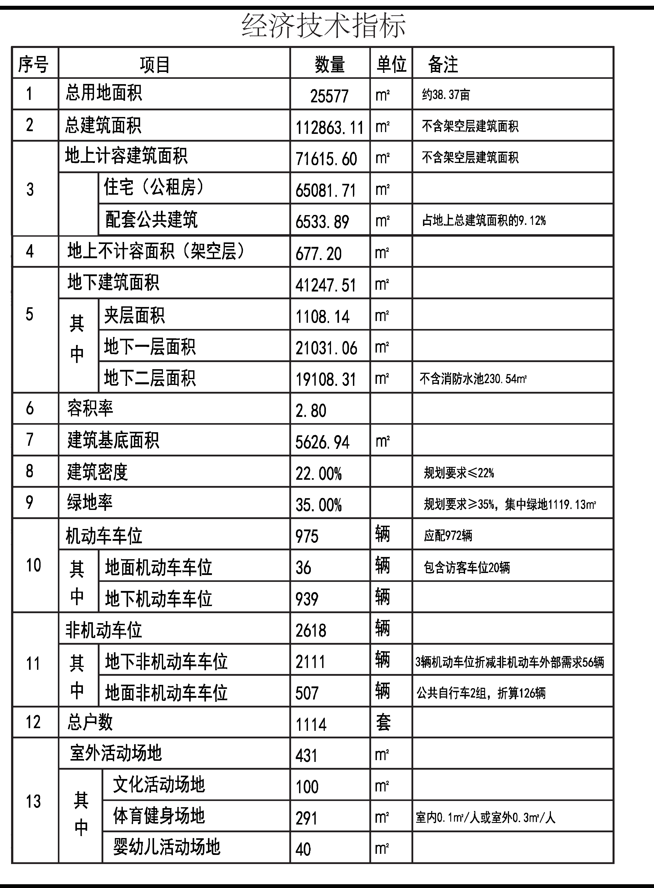
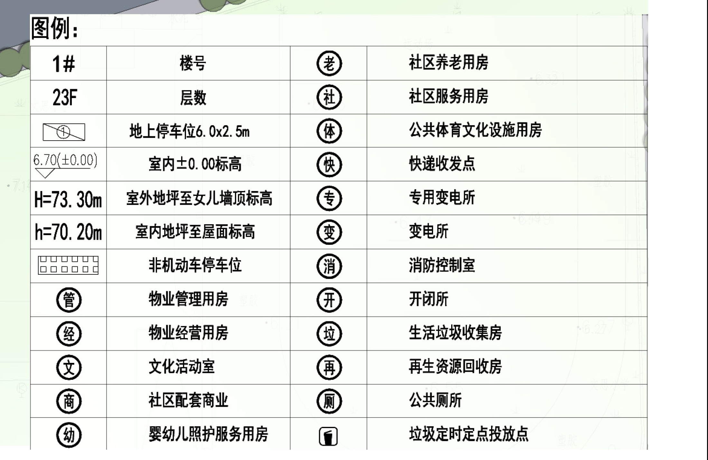

# 下沙资料补证记录

核读日期：2026-10-22。当前采用2022年初步设计公示阶段，非批准图或竣工图。

## 已取得的一手材料

- [钱塘区政府《下沙公租房一期公示》，2022-09-02](https://www.qiantang.gov.cn/art/2022/9/2/art_1657687_58944568.html)。通过政府公开站内搜索定位原页，已实际请求原页和附件。通用搜索工具对该原页访问失败，不影响已取得的公开原件；不将搜索摘要当成图纸核验。
- [原页附件公示图.zip](https://www.qiantang.gov.cn/api-gateway/jpaas-web-server/front/document/file-download?fileUrl=/cms_files/jcms1/web3176/site/attach/0/78df19aee5864811a02f6f1b5c4c92b1.zip)。内含14044×9934像素的公示图.JPG，已经查看全图、经济技术指标、图例及逐栋标注。
- [2024-06-28政府建设进度报道](https://www.qiantang.gov.cn/art/2024/6/28/art_1657686_58966244.html)。公开站内搜索正文与原图逐栋标注一致：1栋22层、7栋23层、1114户；不是结构设计总说明。

原附件及原图的SHA-256保存在 [manifest.json](manifest.json)。为避免将17MB原图重复加入仓库，提交两个仅裁切、未改文字或数值的核读摘录：

## 能填与不能填

| 内容 | 本次处理 | 原因 |
| --- | --- | --- |
| 建筑密度上限 | density_max=0.22 | 指标第8项备注直接写明“规划要求≤22%” |
| 用地、计容、住宅、配套、地下、基底 | 补为同阶段背景 | 都在同一经济技术指标表，避免混合债券与竣工阶段 |
| 总建筑面积 | 112863.11m²，另记不含架空 | 表中明确排除架空677.20m²，不能机械把所有面积相加 |
| 容积率2.80 | 只记design_far，far_max留空 | 此行没有规划上限文字或不等式，不能把设计值作为控制值 |
| H=73.30m / h=70.20m | 只记两种设计高度，height_max留空 | 分别从室外地坪至女儿墙顶、室内地坪至屋面，均不是限高 |
| 逐栋层数 | 保存4号22层、其他7栋23层 | 候选方案仍统一23层，明确为教学简化 |
| 设防烈度 | 留空 | 公示图未给出；未取得本项目结构设计总说明或设防批复 |
| B的预制墙底剪力占比 | 留空 | B是教学自拟MiC路线，需要该假设设计的计算书，不能用真实项目公开规模代替 |

## 其他线索与边界

[2025-02-13调整公示转载](https://www.sohu.com/a/858652666_667411)附图可读总面积113103.79m²、地上计容71615.60m²、住宅65144.79m²、配套6470.81m²、地下41488.19m²。已核读转载图，但尚未取得政府该次调整原件；仅作差异记录，不替换当前的一手材料阶段。

继续检索了政府站内的项目名称、调整公示、初步设计、设防和EPC词组，以及参建单位项目介绍。未取得可确认本项目设防、容积率控制上限或规划限高的原件。部分参建单位网站存在证书/访问问题；搜索摘要中“6度/7度”与相邻项目混排，不能引用为本项目设防结论。未以相邻地块、同区工程、设计高度或面积比补数。

下一步有效材料是：规划条件书/用地出让或划拨控制条件、建设工程规划许可附图或批准总平面图、结构设计总说明/设防审查材料，以及B自拟方案的结构计算书。未联系项目单位或提交信息公开申请。
