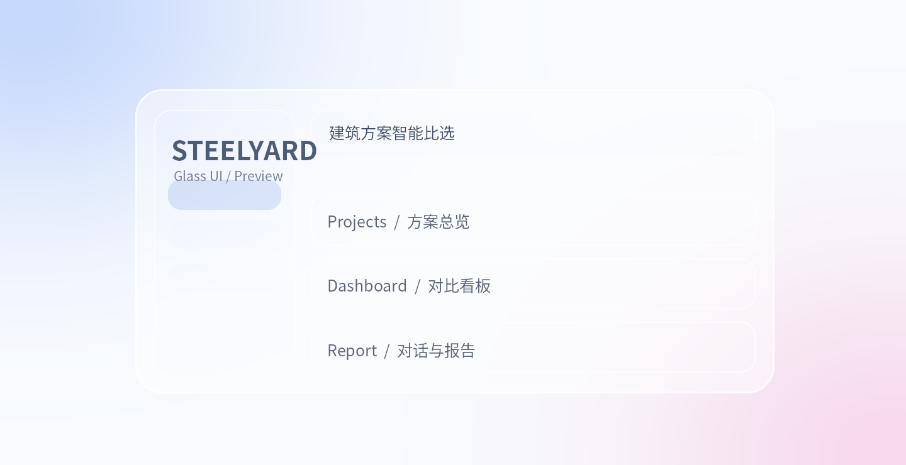

# Steelyard（筑衡）UI 改造资源手册

> Liquid Glass / 柔和双色光晕 / 设计 Skill 与组件库索引
> 整理日期：2026-10-12；基于公开仓库 README 与 Steelyard `main` 分支。安装方式以对应项目最新版说明为准。



*上图为依据本文 CSS 原理制作的概念示意，不是任何第三方库的官方截图。*

## 01. 用于 Steelyard 的总体判断

- **当前技术栈：**Steelyard 仓库 main 分支：React 18 + TypeScript + Vite 5、Ant Design 5、ECharts；全局视觉变量位于 frontend/src/theme.ts，主要工作台样式位于 frontend/src/workbench.css。
- **总体原则：**不要重构业务逻辑、路由、API、数值计算或图表。先统一背景和设计 Token，再对侧栏、顶栏、面板做 CSS 换肤，最后只给少数重点控件加入真正的折射特效。
- **推荐组合：**UI/UX Pro Max（统一设计）＋两层 radial-gradient（背景）＋现有 Ant Design（表单/表格）＋ React Bits 的 Glass Surface（局部增强）。
- **设计参数：**背景采用近白冷色 #f8fafc；左上蓝紫 rgba(125,167,255,.36)、右下粉色 rgba(247,164,207,.32)；卡片 blur 20px，圆角 20px，柔和白色边线与阴影。

**选择时的一个重点：**Steelyard 现在没有 Tailwind；React Bits 选择 **TS + CSS** 版本。GlassKit / liquid-glass-react 可以局部使用，而 Glin UI 作为整套组件体系接入的成本更高。

## 02. 索引（全部项目）

| 名称 | 类型 | 主要用途 | 建议 |
|---|---|---|---|
| [Anthropic Frontend Design](https://github.com/anthropics/claude-code/tree/main/plugins/frontend-design) | AI 设计 Skill / Plugin | 约束 AI 的审美和成品质量：强化排版、层次、配色、动效，减少千篇一律的 AI 风格。 | 建议参考 |
| [UI/UX Pro Max](https://github.com/nextlevelbuilder/ui-ux-pro-max-skill) | AI 设计 Skill | 提供设计系统、色板、字体、UX 规范和图表指导 | 优先 |
| [Liquid Glass Design Skill](https://github.com/xinlingfeiwu/liquid-glass-design-skill) | AI 液态玻璃 Skill / 模板 | CSS + SVG 位移折射、边缘高光、色散和 React 模板，用于让 AI 生成真正带光学感的局部控件。 | 可选增强 |
| [Gradient Backdrops](https://github.com/nonlineartom/gradient-backdrops) | 背景效果库 + Claude Code Skill | WebGL 流动渐变，Mesh、Aurora、Silk 等多种预设，也包含纯 CSS 背景方案。 | 备选 |
| [Glin UI](https://github.com/GLINCKER/glinui) | React 玻璃风组件库 | Radix + Tailwind 体系，提供玻璃按钮/卡片/输入框以及 Gradient Mesh、Aurora Background 等。 | 参考为主 |
| [React Bits](https://github.com/DavidHDev/react-bits) | React 动效组件素材库 | 可复制的交互、渐变背景、动画文字、Glass Surface 等 | 优先 |
| [liquid-glass-react](https://github.com/rdev/liquid-glass-react) | React 液态玻璃组件 | 折射、色散、镜面边缘光、悬停与弹性反馈 | 局部优先 |
| [GlassKit](https://github.com/JUNGHERZ/GlassKit) | 纯 CSS 玻璃组件库 | 玻璃按钮、卡片、导航、表单等，多主题与 CSS 设计变量，带 SKILL.md | 优先参考 |
| [Mesh Gradient Generator](https://github.com/Bifiku/mesh-gradient-generator) | 静态背景生成器 | 拖动柔和色点，调节模糊、颗粒、亮度，导出 PNG、JPG 或 SVG。 | 优先 |
| [Aurora Gradient Editor](https://github.com/a-bashtannik/aurora-gradient-editor) | 渐变背景生成器 | 基于 OKLCH 的柔光色团编辑器，调色更协调，可导出 CSS / SwiftUI。 | 优先 |
| [GlassKit Web](https://github.com/JUNGHERZ/GlassKit-Web) | 整站模板（Astro） | 完整玻璃风的网站页面结构、区块、设计系统及明暗主题，可直接查看成品视觉。 | 设计参考 |

## 03. 资源详情（URL、安装、效果与注意事项）

### 01. Anthropic Frontend Design
- **GitHub：** https://github.com/anthropics/claude-code/tree/main/plugins/frontend-design
- **分类：** AI 设计 Skill / Plugin
- **作用和效果：** 约束 AI 的审美和成品质量：强化排版、层次、配色、动效，减少千篇一律的 AI 风格。
- **使用/安装（已核对仓库说明）：** Claude Code 的官方插件资料；可参考仓库中的 README/技能文件。未确认通用 Codex 一键安装命令，不写死。
- **放到 Steelyard 哪儿：** 用于给设计 AI 定风格、审查视觉方案，不是运行时 UI 库。
- **注意：** 偏向 Claude Code 生态；Codex 可参考其设计原则，不应假设官方即插即用。

### 02. UI/UX Pro Max
- **GitHub：** https://github.com/nextlevelbuilder/ui-ux-pro-max-skill
- **演示/官网：** https://uupm.cc/
- **分类：** AI 设计 Skill
- **作用和效果：** 提供设计系统、色板、字体、UX 规范和图表指导；适合在改造开始前统一设计 Token。
- **使用/安装（已核对仓库说明）：** 在 Steelyard 仓库根目录运行：npx ui-ux-pro-max-cli init --ai codex
若使用全局 CLI：npm install -g ui-ux-pro-max-cli；uipro init --ai codex。
- **放到 Steelyard 哪儿：** 先由 Codex 制定轻量设计系统，再改 theme.ts / workbench.css。
- **注意：** 需要 Python 3.x 以运行部分检索脚本；Skill 不是项目运行依赖。

### 03. Liquid Glass Design Skill
- **GitHub：** https://github.com/xinlingfeiwu/liquid-glass-design-skill
- **演示/官网：** https://github.com/xinlingfeiwu/liquid-glass-design-skill#try-the-react-demo
- **分类：** AI 液态玻璃 Skill / 模板
- **作用和效果：** CSS + SVG 位移折射、边缘高光、色散和 React 模板，用于让 AI 生成真正带光学感的局部控件。
- **使用/安装（已核对仓库说明）：** 仓库给出 Codex 安装流程（Linux/WSL）：git clone https://github.com/xinlingfeiwu/liquid-glass-design-skill.git；再将 skills/liquid-glass-design 链接或复制到 ~/.codex/skills/liquid-glass-design。
- **放到 Steelyard 哪儿：** 适用于导航栏、按钮、工具条；可让 Codex 按 Skill 复刻，而非重写整个页面。
- **注意：** 真实折射需测试 Chromium、Safari、Firefox；不要对大面积数据面板滥用。

### 04. Gradient Backdrops
- **GitHub：** https://github.com/nonlineartom/gradient-backdrops
- **分类：** 背景效果库 + Claude Code Skill
- **作用和效果：** WebGL 流动渐变，Mesh、Aurora、Silk 等多种预设，也包含纯 CSS 背景方案。
- **使用/安装（已核对仓库说明）：** Claude Code 项目级：git clone https://github.com/nonlineartom/gradient-backdrops.git .claude/skills/gradient-backdrops；也可直接查看其 examples / CSS recipes。
- **放到 Steelyard 哪儿：** 想要低速动态背景时参考，不是静态两团色晕的必需依赖。
- **注意：** 动态 shader 需要特别注意低性能设备与 reduced-motion。

### 05. Glin UI
- **GitHub：** https://github.com/GLINCKER/glinui
- **分类：** React 玻璃风组件库
- **作用和效果：** Radix + Tailwind 体系，提供玻璃按钮/卡片/输入框以及 Gradient Mesh、Aurora Background 等。
- **使用/安装（已核对仓库说明）：** 官方两种方式：npx glinui init 后 npx glinui add button glass-card input；或 npm install @glinui/ui @glinui/tokens。
- **放到 Steelyard 哪儿：** 借鉴组件结构和背景设计，或在小范围引入特定组件。
- **注意：** Steelyard 当前用 Ant Design + 普通 CSS，没装 Tailwind；全套迁入会带来额外样式体系。

### 06. React Bits
- **GitHub：** https://github.com/DavidHDev/react-bits
- **演示/官网：** https://reactbits.dev/
- **分类：** React 动效组件素材库
- **作用和效果：** 可复制的交互、渐变背景、动画文字、Glass Surface 等；支持 TypeScript + 普通 CSS。
- **使用/安装（已核对仓库说明）：** 无需整体安装。进入单个组件页面选择 TS + CSS，再复制 TSX/CSS，按该组件说明安装依赖；官网也支持 shadcn/jsrepo CLI。
- **放到 Steelyard 哪儿：** Steelyard 首选的局部特效库；可与 React 18、Vite、Ant Design 共存。
- **注意：** 个别背景依赖 WebGL / 额外包；许可为 MIT + Commons Clause，正式使用前阅读 LICENSE。

### 07. liquid-glass-react
- **GitHub：** https://github.com/rdev/liquid-glass-react
- **分类：** React 液态玻璃组件
- **作用和效果：** 折射、色散、镜面边缘光、悬停与弹性反馈；直接包裹指定 UI。
- **使用/安装（已核对仓库说明）：** 在 frontend 目录运行：npm install liquid-glass-react；import LiquidGlass from "liquid-glass-react"。
- **放到 Steelyard 哪儿：** 用于一个重要按钮、导航胶囊、悬浮操作区等。
- **注意：** 官方说明 Safari/Firefox 不完整支持位移折射，会表现为降级的模糊玻璃。

### 08. GlassKit
- **GitHub：** https://github.com/JUNGHERZ/GlassKit
- **演示/官网：** https://glasskit.jungherz.com/
- **分类：** 纯 CSS 玻璃组件库
- **作用和效果：** 玻璃按钮、卡片、导航、表单等，多主题与 CSS 设计变量，带 SKILL.md；不依赖 React。
- **使用/安装（已核对仓库说明）：** 在 frontend 目录运行：npm install @jungherz-de/glasskit；在 main.tsx 导入 @jungherz-de/glasskit/glasskit.css。
- **放到 Steelyard 哪儿：** 适合直接复用材质的 CSS 配方与设计 Token，渐进替换部分布局样式。
- **注意：** 要避免其 glass-* 类和既有 .panel / Ant Design 重复施加样式。

### 09. Mesh Gradient Generator
- **GitHub：** https://github.com/Bifiku/mesh-gradient-generator
- **演示/官网：** https://bifiku.github.io/mesh-gradient-generator/
- **分类：** 静态背景生成器
- **作用和效果：** 拖动柔和色点，调节模糊、颗粒、亮度，导出 PNG、JPG 或 SVG。
- **使用/安装（已核对仓库说明）：** 无需安装，使用在线工具；离线可 clone 后打开 index.html，或运行 node serve.js。
- **放到 Steelyard 哪儿：** 把蓝紫色点放左上、粉色点放右下，再导出背景图。
- **注意：** 图片在大屏缩放时可能有分辨率问题；简单场景首选 CSS 渐变。

### 10. Aurora Gradient Editor
- **GitHub：** https://github.com/a-bashtannik/aurora-gradient-editor
- **演示/官网：** https://github.com/a-bashtannik/aurora-gradient-editor
- **分类：** 渐变背景生成器
- **作用和效果：** 基于 OKLCH 的柔光色团编辑器，调色更协调，可导出 CSS / SwiftUI。
- **使用/安装（已核对仓库说明）：** 无需构建；git clone https://github.com/a-bashtannik/aurora-gradient-editor.git；打开 index.html。
- **放到 Steelyard 哪儿：** 用来确定两团光晕的位置、色相与柔和程度，可将生成的 CSS 改写到全局背景。
- **注意：** CSS 输出可能用现代 oklch()；需要考虑目标浏览器兼容性。

### 11. GlassKit Web
- **GitHub：** https://github.com/JUNGHERZ/GlassKit-Web
- **演示/官网：** https://glasskit-web.jungherz.com/
- **分类：** 整站模板（Astro）
- **作用和效果：** 完整玻璃风的网站页面结构、区块、设计系统及明暗主题，可直接查看成品视觉。
- **使用/安装（已核对仓库说明）：** 仅试用模板：git clone https://github.com/JUNGHERZ/GlassKit-Web.git；cd GlassKit-Web；npm install；npm run dev。
- **放到 Steelyard 哪儿：** 借鉴页面布局、间距与主题，而不是把 Steelyard 的 Vite React 项目迁移为 Astro。
- **注意：** 技术栈不同；直接套整站模板会变成不必要的重构。

## 04. React Bits 中前面单独提到的组件与工具

### Glass Surface
- **URL：** https://reactbits.dev/components/glass-surface
- **效果：** 圆角玻璃面板及其背后内容的折射；适合悬浮导航条、工具条。
- **接入：** React Bits 页面切到 TS + CSS，复制组件和样式；按页面要求装依赖。
- **注意：** 不适合密集数据表格全面使用。

### Soft Aurora
- **URL：** https://reactbits.dev/c/backgrounds/soft-aurora
- **效果：** 柔和的极光 shader，Perlin 噪声和色彩流动；整体氛围安静。
- **接入：** React Bits 页面切到 TS + CSS，复制并按依赖提示配置。
- **注意：** 动效背景比静态 CSS 更耗资源。

### Grainient
- **URL：** https://reactbits.dev/backgrounds/grainient
- **效果：** 带颗粒纹理和柔和波浪扭曲的渐变背景。
- **接入：** React Bits 页面切到 TS + CSS，复制并按依赖提示配置。
- **注意：** 需约束颗粒强度，防止内容区域显得花。

### Background Studio
- **URL：** https://reactbits.dev/
- **效果：** React Bits 的背景制作工具，可交互预览并导出图像、视频或代码。
- **接入：** 在线使用，无需在 Steelyard 安装整个组件仓库。
- **注意：** 导出代码需自查依赖与许可证。

## 05. 原示例 CSS（完整保留）

这是之前聊天里那份最小示例；只能实现柔光背景和普通毛玻璃，**不等于真实的液态折射**。

```css
body {
  background:
    radial-gradient(
      ellipse 65% 65% at 0% 0%,
      rgba(125, 167, 255, 0.36),
      transparent 75%
    ),
    radial-gradient(
      ellipse 65% 65% at 100% 100%,
      rgba(247, 164, 207, 0.32),
      transparent 75%
    ),
    #f8fafc;
}

.glass-card {
  background: rgba(255, 255, 255, 0.5);
  backdrop-filter: blur(20px) saturate(140%);
  border: 1px solid rgba(255, 255, 255, 0.75);
  border-radius: 20px;
  box-shadow: 0 12px 38px rgba(35, 54, 100, 0.08);
}
```

## 06. Steelyard 定制 CSS 草案

下方是面向 `frontend/src/workbench.css` 的试验性补充示例，供 Codex 参考；它**不是可以不检查就直接贴入生产**的最终补丁（仍需检查层叠优先级、Ant Design 弹窗、图表和移动端）。

```css
/* Steelyard 可在新样式文件中先试验，不直接覆盖原有规则 */
html, body, #root { min-height: 100%; }
body {
  background:
    radial-gradient(ellipse 65% 65% at 0% 0%,
      rgba(125,167,255,.36), transparent 75%),
    radial-gradient(ellipse 65% 65% at 100% 100%,
      rgba(247,164,207,.32), transparent 75%),
    #f8fafc;
  background-attachment: fixed;
}
/* 注意：现有 #root / .app-rail / .topbar / .panel 采用不透明背景。
   需要同步调整原有规则的优先级，保证色晕不被白底盖住。 */
.app-shell, .app-body { background: transparent; }
.app-rail, .topbar {
  background: rgba(255,255,255,.56);
  backdrop-filter: blur(20px) saturate(140%);
  -webkit-backdrop-filter: blur(20px) saturate(140%);
}
.panel {
  background: rgba(255,255,255,.66);
  border: 1px solid rgba(255,255,255,.78);
  border-radius: 20px;
  box-shadow: 0 12px 38px rgba(35,54,100,.07);
}
@media (prefers-reduced-transparency: reduce) {
  .app-rail, .topbar, .panel { background: #fff; }
}
```

## 07. 建议的实现顺序

1. 在独立分支试验，先改 `frontend/src/theme.ts` 和工作台整体背景，保持页面结构不动。
2. 把侧栏、顶栏、项目卡片与 `.panel` 统一换成低透明度玻璃材质，先确认文本/图表可读。
3. 只给导航胶囊或主要操作条试用 React Bits **Glass Surface**（TS + CSS），或者 `liquid-glass-react`，二选一试点。
4. 背景先用静态 CSS；真正需要动态气氛时再考虑 **Soft Aurora** / **Grainient** / Gradient Backdrops。
5. 对项目总览、方案录入、对比看板、对话与报告做桌面/移动端回归测试，检查透明度、滚动、卡片高度、遮挡、浏览器降级。

## 08. 给 Codex 的简短任务说明

> 请在 Steelyard（Vite + React + TS + Ant Design）的现有布局上做 UI 换肤，不改变业务逻辑、路由、API、ECharts 配置或表单行为。总体风格为浅色 macOS Liquid Glass：近白背景，左上柔和蓝紫色光晕，右下淡粉色光晕，中部留白；卡片与顶栏适度毛玻璃，重点导航少量使用真实折射。请先审阅 `frontend/src/theme.ts` 与 `frontend/src/workbench.css`，制定统一设计 Token，在独立分支完成渐进修改。优先使用 React Bits 的 TypeScript + CSS 组件，先校验响应式、文本对比度、浏览器兼容性和原有测试，再考虑动态背景。

## 09. 核对范围与免责声明

- 链接与安装说明均来自对应项目的公开 README / 官网页面核对；仍可能因更新而变化。
- “Liquid Glass Skill”此前只是泛称，这里明确补充的是适合 Web/React 的 **Liquid Glass Design Skill** 仓库，并非特指唯一官方技能。
- React Bits 使用 MIT + Commons Clause，使用前请核实具体许可；第三方项目的截图、壁纸与商标版权可能另有约束。
- 概念示意图为本次制作；它展示配色与层次方向，不代表真实的 SVG 光学折射。
