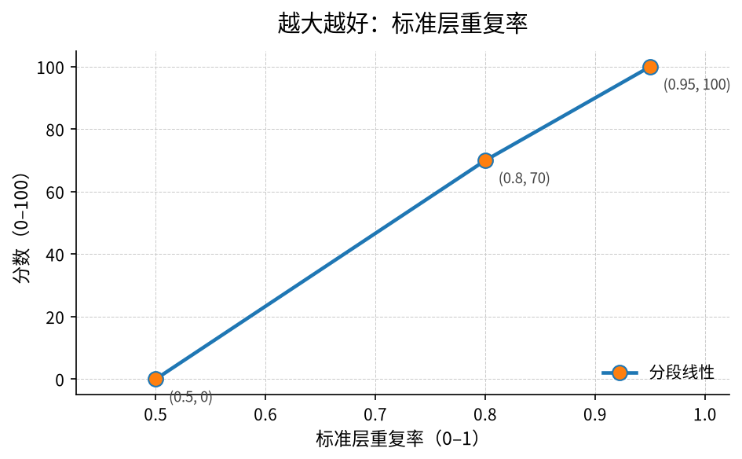
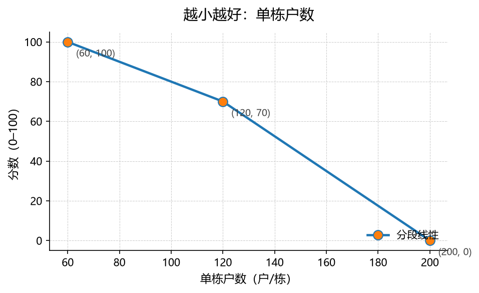
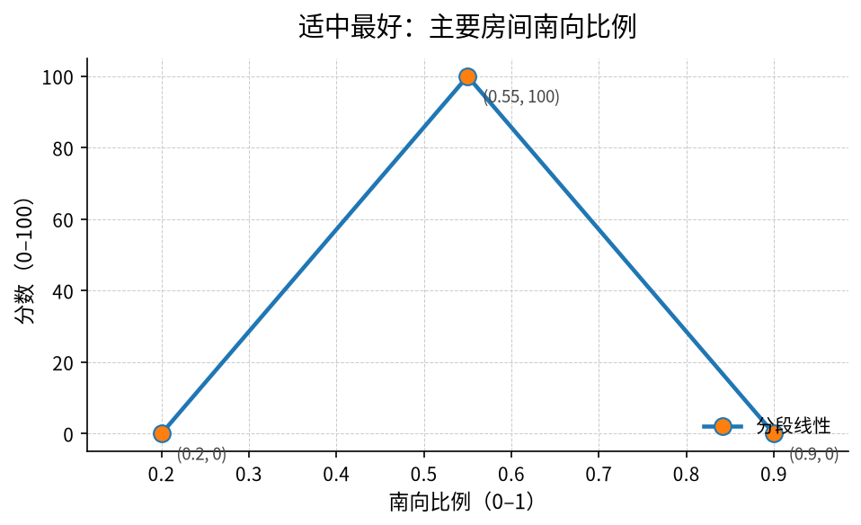

# 规则编写指南（给土木与建筑专业的同学）

> 这份文档面向**没写过代码、但懂建筑专业的同学**。你只需要会写字和处理简单表格，
> 就能写出筑衡引擎能读懂的规则。读完这份指南，你应当能独立写出符合
> `check_rules` 校验的硬约束与评分指标，并通过 GitHub 网页提交 Pull Request。

整个文档尽量口语化；遇到术语当场解释；所有数值都标注「示例数值」，
**不引用任何真实规范条文号**——这些由对应专业组填写。

> 📋 **要填哪些值、要定哪些事，逐条列在 [open-items.md](open-items.md) 第一部分**
> （当前规则的阈值、分段点、维度权重与尚未覆盖的专业条件）。
> 这份指南教你「怎么写」，那份清单告你「写什么」。

---

## 目录

1. [五分钟看懂 YAML](#1-五分钟看懂-yaml)
2. [字段对照表（自动生成，不要手改）](#2-字段对照表自动生成不要手改)
   - [2.1 规则编号怎么取](#21-规则编号怎么取)
3. [硬约束（hard）怎么写](#3-硬约束hard怎么写)
4. [评分指标（metric）怎么写](#4-评分指标metric怎么写)
5. [source 字段怎么填](#5-source-字段怎么填)
6. [在 GitHub 网页上修改规则并提交 PR](#6-在-github-网页上修改规则并提交-pr)
7. [怎么看 check_rules 报错](#7-怎么看-check_rules-报错)
8. [一页速查卡](#8-一页速查卡)

---

## 1. 五分钟看懂 YAML

筑衡的规则文件都是 YAML 格式（文件后缀 `.yaml` 或 `.yml`）。YAML 的设计目标就是
"人能直接读"，所以你只需要记住下面几条规则。

### 1.1 缩进：用 2 个空格，不要用 Tab

YAML 用**缩进**表示层级关系，缩进多的属于缩进少的「下面」。缩进必须用空格键，
**严禁用 Tab 键**——混用空格和 Tab 是 90% 的报错来源。

下面这段是对的（每个 `- ` 前 0 空格，字段前 2 空格）：

```yaml
- id: C-03
  name: 住宅层高下限
  type: hard
  check: "floor_height >= 3.0"
```

下面这段是错的（用了 Tab 缩进）：

```yaml
- id: C-03
  name: 住宅层高下限
⇥type: hard
⇥check: "floor_height >= 3.0"
```

> 「⇥」表示一个 Tab 字符。VS Code 默认按一下 Tab 会插入 4 个空格，那样没事；
> 但**如果你从网上复制粘贴、或者从 Excel 粘贴到文本编辑器**，很容易带进真 Tab。
> 检查办法：在编辑器右下角看到「Spaces: 4」或类似字样才对。

### 1.2 冒号：必须是英文半角冒号 `:`

YAML 用**冒号**分隔"字段名"和"字段值"，且必须是英文半角冒号（`:`）。
中文里那种「：」比英文「:」宽一格，**YAML 不认**。

```yaml
# ✅ 正确：英文冒号
id: C-03

# ❌ 错误：中文冒号
id：C-03
```

编辑器里看到全角「：」就立刻改成半角「:」。本仓库的 `check_rules` 会自动报这一类错。

### 1.3 列表：用 `- ` 开头

同一层的多个项目用 `- ` 起头，且 `- ` 后必须跟一个空格：

```yaml
- id: K-01
  name: 标准层重复率
- id: K-02
  name: 单栋户数
```

### 1.4 引号：什么时候该加引号

**最简原则**：值里没有特殊字符（`#`、冒号、引号、换行）就不加引号；
有就加双引号 `"..."`。

```yaml
name: 住宅层高下限         # ✅ 中文不强制加引号
check: "floor_height >= 3.0"  # ✅ 含 >= 和空格，加双引号更安全
message: '层高 {floor_height} m 低于 3.0 m'  # ✅ 也可用单引号
```

### 1.5 最常见的三种错误速查

| 错误样子 | 错在哪里 | 怎么改 |
| --- | --- | --- |
| `⇥check: "..."` | 用了 Tab 缩进 | 全选当前层，按一次 Tab → 改成 2 个空格 |
| `id：C-03` | 用了中文全角冒号 | 把 `：` 替换成英文 `:` |
| 子键缩进与兄弟节点差 1 个空格 | 缩进不齐（典型表现：第二条规则的子键比第一条多缩了一格） | 让同一条规则里的所有字段对齐到同一列（统一 2 个空格） |

每个错误 `check_rules` 都会单独报一行，并指出**行号**，照着行号找就行。

---

## 2. 字段对照表（自动生成，不要手改）

写规则时经常会问"这个字段叫什么？单位是 m 还是 m²？"——下面的表把
项目层、方案层与派生量全部列出来。**它由脚本从 JSON Schema 自动渲染**，
改模型后请重新跑：

```bash
uv run --project backend python scripts/gen_field_table.py
```

CI 会用 `--check` 选项校验，磁盘文件与重新生成结果不一致就报错，
防止文档与代码漂移。详见 [fields.generated.md](fields.generated.md)。

> 一句话记忆：**字段名用英文小写下划线；单位看表；比例字段一律填 0–1 小数**
> （如 0.82 表示 82%，不要写 82）。

### 2.1 规则编号怎么取

每条规则都要有一个**全局唯一**的编号（`id`），格式是**一个大写字母 + 短横线 + 两位数字**，
比如 `C-03`、`Q-01`、`K-12`。**前缀按维度选，不按文件选**——同一个维度可以拆成多个文件
（例如结构既有 `structure.yaml` 也有 `structure_mic.yaml`，都用 `S`）：

| 前缀 | 维度 | 常见文件 |
| --- | --- | --- |
| `C` | 规范硬约束（合规 / 规划条件） | `rules/compliance.yaml` |
| `Q` | 居住品质 | `rules/quality.yaml` |
| `S` | 结构安全（含 **MiC 专项**、地基基础） | `rules/structure.yaml`、`rules/structure_mic.yaml` |
| `K` | 施工友好 / **施工安全（危大工程）** | `rules/construction.yaml` |
| `G` | 绿色低碳 | `rules/green.yaml` |

> 运行期在界面上新增的规则用 `X`（见 `docs/design-custom-add.md`）：
> 它们不来自文件、不进 git、不参与 CI 校验，用独立前缀才能一眼区分。

**为什么管这么严**：报告里每个结论后面都会跟一个规则编号，评委可以顺着编号回查依据。
编号格式统一、全局不重，这条链才走得通。想写 `C-层高` 这种"看得懂的编号"是好意，
但编号会出现在报告、前端、数据库里，中文和不定长会带来一连串麻烦——名字写在 `name` 里就好。

新加一条规则时，**在同一个文件里往后顺一个没用过的数字**即可（不必连续）。
编号撞了 `check_rules` 会报错，并告诉你另一处在哪一行。

---

## 3. 硬约束（hard）怎么写

硬约束：方案**违反**这一条，就直接**标红、踢出排名**——不参与比选。
每条硬约束对应一行规则 YAML。

### 3.1 字段一览

| 字段 | 是否必填 | 含义 |
| --- | --- | --- |
| `id` | ✅ | 规则编号，全局唯一。格式固定为 **一个大写字母 + 短横线 + 两位数字**，如 `C-03`；前缀按维度选（见 [2.1](#21-规则编号怎么取)） |
| `name` | ✅ | 中文名，给前端 / 报告看 |
| `type` | ✅ | 固定写 `hard` |
| `check` | ✅ | 一个布尔表达式，违反即不通过 |
| `message` | 可选 | 不通过时给用户看的说明，可以用 `{字段名}` 占位实际取值 |
| `when` | 可选 | 守卫表达式：为真时才检查 `check`；详见 3.4 |
| `severity` | 可选 | `error`（默认，标红并踢出排名）或 `warning`（只提示，不影响排名） |
| `source` | ✅ | 条文 / 经验出处，见第 5 节 |

`check` 表达式支持的运算符：`>=`、`<=`、`>`、`<`、`==`、`!=`、`and`、`or`、`not`，
以及 `contains`（判断列表是否含某元素）。

两个字典字段支持固定字符串键：`window_wall_ratio['南']`、`unit_mix['两室']`。
这些取值可用于 `check`、`when` 和指标 `value`；只允许 `window_wall_ratio` / `unit_mix`
直接配一个引号包围的字符串键，不能使用变量键、数字下标、切片、嵌套下标、属性或函数返回值。
键名必须与录入数据一致。评价方法与阈值仍由专业组确认。

字典未填或引用的键不存在时记为「数据不足」，不会填成 0；指标不计分。
引擎检查表达式引用的全部字段和键，即使它们位于 `and` / `or` 的短路分支。
例如其他条件已经为假时，仍需补齐表达式引用的 `window_wall_ratio['南']`。

### 3.2 示例 1：简单比较

> 层高不低于 3.0 m（示例数值，待专业组确认条文号）。

```yaml
- id: C-03
  name: 住宅层高下限
  type: hard
  check: "floor_height >= 3.0"
  message: "层高 {floor_height} m 低于 3.0 m"
  source: "TODO(专业组)：示例数值，正式条文号待补"
```

完整文件见 [`hard_simple.yaml`](../backend/tests/fixtures/guide_examples/hard_simple.yaml)。

### 3.3 示例 2：用派生量

派生量由引擎在评估时计算（详见字段对照表的"派生量"段）。
规则里直接当字段名引用即可：

> 体形系数（外表面积 / 体积）不超过 0.5（示例数值）。

```yaml
- id: C-10
  name: 体形系数上限
  type: hard
  check: "shape_coef <= 0.5"
  message: "体形系数 {shape_coef} 偏大，建筑能耗与造价不利"
  source: "TODO(专业组)：示例数值，正式条文号待补"
```

完整文件见 [`hard_derived.yaml`](../backend/tests/fixtures/guide_examples/hard_derived.yaml)。

### 3.4 示例 3：带 `when` 条件

`when` 是一个布尔表达式；**只有它为真时才执行 `check`**。常见用法：
"只在某种结构 / 某种气候区 / 某种体量下"才检查某项。

> 仅当结构体系是钢结构时，要求方案把「防火达标」列入风险特征（示例规则）。

```yaml
- id: C-11
  name: 钢结构防火涂层（条件检查）
  type: hard
  when: "structure_type == '钢结构'"
  check: "risk_features contains '防火达标'"
  message: "钢结构方案必须把「防火达标」列入风险特征并由人工复核"
  source: "TODO(专业组)：示例数值，正式条文号待补"
```

完整文件见 [`hard_when.yaml`](../backend/tests/fixtures/guide_examples/hard_when.yaml)。

---

## 4. 评分指标（metric）怎么写

评分指标：方案**不会因不达标被踢出**，但每个指标算一个 0–100 的分数，
最后按维度加权汇总。**指标不是"有没有"的问题，而是"好不好"的问题。**

### 4.1 用「画一条折线」来理解 points

每个 metric 都有一段 `scoring.points`，形如：

```yaml
scoring:
  kind: piecewise
  points:
    - [0.50, 0]
    - [0.80, 70]
    - [0.95, 100]
```

把它当成**画一条折线**：

- **横轴**是指标的真实取值（比如"标准层重复率 = 0.82"）；
- **纵轴**是分数（0 到 100）；
- 列表里每一对 `[指标值, 分数]` 就是折线上的一个**控制点**；
- 引擎在两个控制点之间**线性插值**（拉一条直线），落到折线上读出分数。

**画 points 之前，先想清楚三个问题**：

1. **多少算 0 分？**（最差情况）——这是第一个控制点的横坐标。
2. **多少算 100 分？**（最理想情况）——这是最后一个控制点的横坐标。
3. **中间有没有拐点？**（不线性变化的位置）——拐点也要单独列。

写完三个问题，`points` 就出来了。

### 4.2 三种常见形态

#### (1) 越大越好



> 标准层重复率越高，模板与构件周转越好。

```yaml
- id: K-01
  name: 标准层重复率（越大越好）
  type: metric
  dimension: construction
  value: "std_floor_repeat"
  scoring:
    kind: piecewise
    points:
      - [0.50, 0]
      - [0.80, 70]
      - [0.95, 100]
  weight_in_dimension: 1
  source: "TODO(专业组)：示例数值，正式条文号待补"
```

完整文件见 [`metric_bigger_is_better.yaml`](../backend/tests/fixtures/guide_examples/metric_bigger_is_better.yaml)。

#### (2) 越小越好



> 单栋户数过多会导致电梯排队与疏散困难，越少越好。

注意：**横轴仍按 x 从小到大排列**（必须严格递增），纵轴随之递减。

```yaml
- id: Q-02
  name: 单栋户数（越小越好）
  type: metric
  dimension: quality
  value: "units_per_building"
  scoring:
    kind: piecewise
    points:
      - [60, 100]
      - [120, 70]
      - [200, 0]
  weight_in_dimension: 1
  source: "TODO(专业组)：示例数值，正式条文号待补"
```

完整文件见 [`metric_smaller_is_better.yaml`](../backend/tests/fixtures/guide_examples/metric_smaller_is_better.yaml)。

#### (3) 适中最好



> 南向比例太低不利于日照，太高又牺牲通风与户型多样性；0.55 附近最理想。

> **注意**：上面这句只是在说明「适中最好」这种**形状**，**不是**当前
> `rules/quality.yaml` 里 Q-02 的实际取值；当前 Q-02 南向比例采用
> **越大越好**的品质偏好评分，不能替代日照校核。Q-01 当前是得房率。
> 本节的字段名、分段点、规则 ID 都只为示意形状，实际数值一律以 `rules/` 目录为准。

适中最好 = **points 先升后降**。横轴仍按 x 严格递增；纵轴先升到 100，
到达峰值后再降回 0：

```yaml
- id: Q-03
  name: 主要房间南向比例（适中最好）
  type: metric
  dimension: quality
  value: "south_room_ratio"
  scoring:
    kind: piecewise
    points:
      - [0.20, 0]
      - [0.55, 100]
      - [0.90, 0]
  weight_in_dimension: 1
  source: "TODO(专业组)：示例数值，正式条文号待补"
```

完整文件见 [`metric_optimal_in_middle.yaml`](../backend/tests/fixtures/guide_examples/metric_optimal_in_middle.yaml)。

### 4.3 `weight_in_dimension` 是什么意思

每个 metric 都属于某个**维度**（`dimension`，取值见下表）；同一维度内的所有
metric 按 `weight_in_dimension` **加权平均**成"维度分"。

| dimension 取值 | 中文名 | 含义 |
| --- | --- | --- |
| `quality` | 居住品质 | 采光、通风、户型、电梯服务、得房率 |
| `structure` | 结构安全 | 结构选型、抗震、风险特征 |
| `construction` | 施工友好 | 标准化、构件种类、施工组织 |
| `green` | 绿色低碳 | 体形系数、节能、装配率 |

**维度归属的两处核定**（2026-10 专业组，对应 open-items §1.8）：

- **得房率归 `quality`**：它直接决定套内可用面积，是居住品质指标；
  材料效率那一层不再单独计分，避免与 `construction` 重复计量。
- **装配率归 `green`**：装配率反映工业化建造与资源效率；`construction`
  一侧已由「预制构件种类数」覆盖施工组织难度，两者不重复。

**举例**：假设 `construction` 维度有 3 个 metric：

| metric | weight_in_dimension |
| --- | --- |
| 标准层重复率 | 1 |
| 预制构件种类数（越小越好） | 2 |
| 装配率 | 1 |

那它们的分数按 1 : 2 : 1 加权平均。如果三个 metric 各自是 80 / 60 / 100 分，
那 `construction` 维度分 = (80×1 + 60×2 + 100×1) / (1+2+1) = 75 分。

权重是相对值（不需要加起来 = 100），只要在同一维度内互相比较即可。

### 4.4 字段一览

| 字段 | 是否必填 | 含义 |
| --- | --- | --- |
| `id` | ✅ | 规则编号，格式同硬约束；前缀按维度选（见 [2.1](#21-规则编号怎么取)） |
| `name` | ✅ | 中文名 |
| `type` | ✅ | 固定写 `metric` |
| `dimension` | ✅ | 所属维度，取值见 4.3 |
| `value` | ✅ | 字段名或表达式 |
| `when` | 可选 | 守卫表达式；为假时该指标对这个方案记「不适用」，不计入维度分 |
| `scoring.kind` | ✅ | 现阶段固定 `piecewise`（分段线性） |
| `scoring.points` | ✅ | 控制点列表，每项 `[指标值, 分数]`；指标值必须严格递增，分数在 0–100 之间 |
| `weight_in_dimension` | 可选 | 同维度内的相对权重（正数），**默认 1**；只有一个维度里指标不等权时才需要写 |
| `source` | ✅ | 条文 / 经验出处，见第 5 节 |

---

## 5. source 字段怎么填

`source` 是这条规则的**出处**，告诉看报告的人"你凭什么这么判 / 这么打分"。
统一写法：

### 5.1 来自规范原文

```
"规范编号 第 X 条"
```

格式建议：**规范编号 + 条文号**，中间用空格隔开。如果一个规则同时参考多条规范，
用分号分隔：

```
"规范甲编号 第 X 条；规范乙编号 第 Y 条"
```

### 5.2 经验规则（土木组）：理由

如果你写的是"组内经验判断，没有对应规范"，用下面的格式：

```
"经验规则（土木组）：标准层越多，模板与构件周转越高"
```

「组名」可以是「土木组 / 建筑组 / 结构组」等，方便追溯"这是谁拍板的"。
「理由」一句话说清"为什么这么定"，别只写"经验"两个字。

### 5.3 示例数值占位

写指南 / 示例时，**先用 `TODO(专业组)：示例数值，正式条文号待补` 占位**，
不要编造任何条文号，也不要凭空写一个阈值。专业组核对完规范原文后再改写。

---

## 6. 在 GitHub 网页上修改规则并提交 PR

完全不用装 Git / Python / VS Code。**整个流程在浏览器里完成**。

### 6.1 打开规则文件

1. 打开仓库首页 `https://github.com/<org>/zhuheng`（org 名称问队长）。
2. 顶部导航点 **Code**，进入文件浏览器。
3. 进入 `rules/` 目录（如 `rules/quality.yaml`）。每个文件名末尾的 `.yaml`
   表示"YAML 格式"，不是必填项。
4. 点击右上角的 ✏️ **Edit this file** 图标。

### 6.2 编辑

1. GitHub 会让你"Fork this repository"——意思是先在你自己的账号下复制一份。
   第一次会让你授权，授权完会自动跳回编辑器。
2. 直接在网页编辑器里改 YAML：
   - 想加新规则，把光标移到文件末尾另起一行，复制一条已有规则改字段值；
   - 想改阈值，改对应数字；
   - 改完滚动到页面底部。
3. 顶部会有提示："**Propose changes**"。在第一个框写"一句话说明这次改了什么"，
   例如 `quality: K-04 调整南向比例分段点`；第二个框可以留空（详细说明放到
   PR 描述里）。

### 6.3 提交

1. 点 **Propose changes** 按钮，GitHub 会把你的改动提交到你的 fork，并自动开一个
   Pull Request（PR）。
2. PR 标题默认就是你刚才写的那句话，可以再改；描述里写清楚"为什么这么改，
   改了哪些数值，有没有参考的规范"。
3. 点 **Create pull request**。
4. 等几分钟后页面会出现 `check_rules` / `pytest` 的检查结果：
   - ✅ 全绿 = 合并等队长审核；
   - ❌ 有红 = 点 **Details** 看失败原因，回到第 6.2 步继续改。

### 6.4 评审与合并

- 队长 / 高年级同学会在 PR 下面评论，问你"为什么改 0.55 不是 0.50"之类的；
  在评论框直接回复即可，每次回复都会自动保存到 PR 历史。
- 评审通过后，队长点 **Merge pull request** → **Confirm merge**，
  改动就合到主分支了。

> **合并后什么时候生效**：后端启动时读一次 `rules/`。本地开发想马上看到效果，
> 不用重启服务，调一次 `POST /api/rules/reload` 即可（这个接口只在开发环境开放）。
> 当前加载了哪些规则可以用 `GET /api/rules` 看。

---

## 7. 怎么看 check_rules 报错

`check_rules` 是仓库自带的小工具，**改完规则后跑一遍**就能发现常见错误。
本节用 5 条实际跑出来的典型报错讲怎么改。

### 7.1 怎么跑

```bash
# 校验整个 rules/ 目录
uv run --project backend python scripts/check_rules.py

# 只校验单个文件
uv run --project backend python scripts/check_rules.py rules/quality.yaml
```

跑完会输出每个文件的 ERROR / WARNING 清单，末尾一行「汇总：X 个文件，
Y 个 ERROR，Z 个 WARNING」。**任何 ERROR 都会让脚本退出码 = 1**，
CI 也会因此失败——必须改完再推。

### 7.2 报错长什么样

每条报错都是**一行**，由四段组成：

```
错误  rules/quality.yaml:13  K-01 — 错在哪 — 怎么改：具体动作
└─┬─┘ └────────┬──────────┘ └─┬─┘
严重程度   文件名:行号        规则编号
```

- **严重程度**：`错误` 必须改完才能合并；`警告` 不拦合并（比如 `source` 还挂着 TODO）。
- **行号是真实行号**，用编辑器跳到那一行就能改。
- **规则编号**帮你在一个放了好几条规则的文件里认出是哪一条；连 `id` 都还没写时显示 `（未知 ID）`。
- **`怎么改：` 后面是具体动作**，照着做即可。

### 7.3 七条典型报错与解法

下面几条都来自仓库 `backend/tests/fixtures/guide_examples/_bad/`，你可以自己跑一遍看：

```bash
uv run --project backend python scripts/check_rules.py backend/tests/fixtures/guide_examples/_bad/
```

#### (1) Tab 缩进

```
错误  _bad/hard_tab_indent.yaml:8  （未知 ID） — 这一行用了 Tab 缩进，YAML 不接受 Tab
      — 怎么改：把行首的 Tab 全部替换成空格；同一层级统一缩 2 个空格
```

**怎么改**：
- **GitHub 网页编辑器**：右下角把 "Indent mode" 切到 Spaces；
- **VS Code**：`Ctrl+H` 打开替换，开启正则模式，搜 `^	+` 替换成两个空格，全文替换一次；
- 只有一两行就直接删掉 Tab 重打 2 个空格。

> 有几行 Tab 就报几行，改完再跑一次确认清零。

#### (2) 中文全角冒号

```
错误  _bad/hard_chinese_colon.yaml:5  （未知 ID） — 这一行用了中文全角冒号「：」
      — 怎么改：把它替换成英文半角冒号「:」。半角冒号比汉字窄，全角冒号和汉字一样宽
```

**怎么改**：把那一行的 `：` 改成 `:`。分不清就看宽度——英文 `:` 是窄的，中文 `：` 和汉字一样宽。

#### (3) 缩进对不齐

```
错误  _bad/hard_unaligned.yaml:13  （未知 ID） — 这一行的缩进和上一行对不齐，YAML 读不懂它属于谁
      — 怎么改：让同一条规则里的所有字段缩进完全一致（统一 2 个空格）；也检查一行里是不是多打了一个冒号
```

**原因**：第二条规则的子键缩了 3 个空格，第一条缩了 2 个。

**怎么改**：所有 `- ` 顶头，所有字段统一缩 2 个空格，**全文对齐到同一列**。

#### (4) 缺必填字段

```
错误  _bad/hard_missing_field.yaml:4  （未知 ID） — 缺少必填字段「id」
      — 怎么改：补一行 `id: C-01`（前缀字母 C/Q/S/K/G + 短横线 + 两位数字，全局唯一）
错误  _bad/hard_missing_field.yaml:4  （未知 ID） — 缺少必填字段「type」
      — 怎么改：补一行 `type: hard`（硬约束）或 `type: metric`（评分指标）
```

**怎么改**：缺几个就补几个，照着 `怎么改` 里给的那一行抄。行号指向这条规则的开头。

#### (5) points 的指标值不是严格递增

```
错误  _bad/metric_points_not_monotonic.yaml:13  K-95 — scoring.points 的指标值（每项第一个数）
      必须严格递增，当前是 [0.95, 0.8, 0.5]；「越小越好」的指标也要按指标值从小到大排，
      靠分数递减来表达 — 怎么改：把控制点按第一个数字从小到大重排
```

**怎么改**：按横坐标从小到大重排：

```yaml
points:
  - [0.50, 0]    # ← 最小的指标值放最上面
  - [0.80, 70]
  - [0.95, 100]  # ← 最大的指标值放最下面
```

**「越小越好」也一样**：横坐标从小到大写，靠分数递减表达。

#### (6) dimension 写错

```
错误  _bad/metric_missing_dimension.yaml:8  K-94 — dimension 只能是
      quality / structure / construction / green 之一，当前写的是 'cost'
      — 怎么改：是不是想写 `construction`？从这四个里选一个
```

**怎么改**：从四个合法值里挑一个，见 4.3 节的表格。如果你觉得真的需要一个新维度，
先找队长对齐（要改 `app/models/eval.py` 的 `DimensionKey`），**不要**直接在 YAML 里造新值。

#### (7) 字段名拼错

```
错误  rules/compliance.yaml:5  C-01 — check 表达式里的 `floor_hieght` 不是已知字段或派生量
      — 怎么改：是不是想写 `floor_height`、`std_floor_repeat`、`floor_efficiency`？
      完整字段表见 docs/fields.generated.md
```

**这是 `check_rules` 最有用的一条**：表达式里的每个名字都会和字段对照表逐个核对，
拼错时直接告你最接近的几个候选。**拼错的字段名不会被悄悄忽略**——否则一条规则
看起来生效了其实从没生效过，比报错危险得多。

规则 ID 写错格式也是同一类报错：

```
错误  rules/compliance.yaml:2  C-SHAPE — 规则 ID「C-SHAPE」格式不对
      — 怎么改：必须是一个大写字母 + 短横线 + 两位数字，例如 C-03、Q-01、K-12
```

### 7.4 报错速查表

| 报错里的关键字 | 含义 | 怎么改 |
| --- | --- | --- |
| Tab 缩进 | 用了 Tab | 替换成空格，统一 2 个 |
| 中文全角冒号 | 用了 `：` | 改成英文半角 `:` |
| 缩进和上一行对不齐 | 缩进不齐 | 同一条规则的字段对齐到同一列 |
| 缺少必填字段 | 少写了 id / name / type / source 等 | 照 `怎么改` 里给的那一行补上 |
| 规则 ID「…」格式不对 | 编号不是「字母-两位数字」 | 见 2.1 节 |
| 规则 ID 重复 | 两条规则用了同一个编号 | 换一个没用过的数字（报错会说另一处在哪行） |
| 无法识别的字段 | 字段名拼错 | 按提示的候选改，或查 `rules/_template.yaml` |
| 同一条规则里重复写了字段 | 同一个字段写了两遍 | 删掉多余那行（YAML 只认最后一个） |
| 指标值…必须严格递增 | points 横坐标没从小到大排 | 按横坐标升序重排 |
| 分数…超出 0–100 | points 纵坐标越界 | 分数改到 0–100 之间 |
| 不是已知字段或派生量 | 表达式里字段名拼错 | 按提示的候选改，查 `docs/fields.generated.md` |
| 表达式写法不合语法 | 括号 / 引号 / 比较符写错 | 检查成对符号；`>=` 不能写成 `=>` |
| dimension 只能是… | 维度取值不合法 | 从四个里选一个 |
| 不应该有…字段 | hard 和 metric 的字段写串了 | hard 用 check/message；metric 用 dimension/value/scoring |

> **退出码**：有任何 `错误` 都会让脚本退出码 = 1，CI 也会因此变红，必须改完才能合并。
> 只有 `警告`（比如 `source` 还是 TODO）时退出码是 0，不拦合并。

## 8. 一页速查卡

> 打印出来贴在桌上。

### YAML 速记

- 缩进：2 空格；**禁用 Tab**。
- 冒号：英文半角 `:`；**禁用全角 `：`**。
- 列表：`- `（横线 + 空格）。
- 引号：含特殊字符或中文以外的多字符值，用双引号包起来。

### 一条 hard 规则的最小骨架

```yaml
- id: C-01             # 编号，一个大写字母 + 短横线 + 两位数字，全局唯一
  name: 中文名           # 给前端 / 报告看
  type: hard             # 固定
  check: "字段 运算符 阈值"  # 布尔表达式
  message: "提示 {字段}"   # 可选：{字段} 会被实际值替换
  # when: "条件"         # 可选：条件为真才检查
  source: "规范编号 第 X 条"  # 或 "TODO(专业组)：..."
```

### 一条 metric 规则的最小骨架

```yaml
- id: K-01             # 编号，前缀按维度选：C/Q/S/K/G
  name: 中文名
  type: metric
  dimension: quality     # quality / structure / construction / green
  value: "字段名"        # 或表达式
  scoring:
    kind: piecewise      # 现阶段唯一支持的类型
    points:
      - [x1, y1]
      - [x2, y2]
      - [x3, y3]
  weight_in_dimension: 1 # 可选，默认 1。同维度内的相对权重
  source: "经验规则（XX组）：理由"
```

### points 三种画法

| 类型 | x 怎么排 | y 怎么排 |
| --- | --- | --- |
| 越大越好 | 从小到大 | 从小到大 |
| 越小越好 | 从小到大 | 从大到小 |
| 适中最好 | 从小到大（横坐标永远从小到大） | 先升到 100 再降下来 |

### 常用命令

```bash
# 校验所有规则
uv run --project backend python scripts/check_rules.py

# 校验单个文件
uv run --project backend python scripts/check_rules.py rules/quality.yaml

# 重新生成字段对照表（模型改了之后跑）
uv run --project backend python scripts/gen_field_table.py

# 跑完测试看指南里的示例还过不过
make test
```

### 改完规则要做的 3 件事

1. 跑 `scripts/check_rules.py`，**所有「错误」都得消除**（「警告」不拦合并）。
2. 在 PR 描述里写清楚改了哪些字段、参考了哪条规范、为什么这么改。
3. 等 CI 全绿、队长评审通过后才会合并；任何红色 ❌ 都不能合。

---

**文档维护**：土木组 / 建筑组同学都可以改这份文档。
改完之后跑一遍 `make test` 确认示例还能通过校验，再提交 PR。
